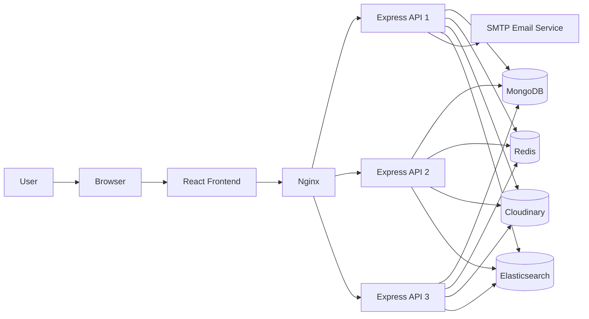

# VidStream

VidStream is a full-stack video streaming platform inspired by YouTube. It allows users to sign up, upload videos, subscribe to creators, like and comment on content, search videos, and manage their watch history.

## System Design



## Features

- JWT-based authentication and refresh tokens
- Video upload, update, delete, and playback
- Subscriptions and channel profiles
- Likes, comments, and community posts
- Search and watch history tracking
- OTP-based password reset via email
- Dockerized deployment with Nginx load balancing

## Tech Stack

- Frontend: React, Vite, Tailwind CSS
- Backend: Node.js, Express.js
- Database: MongoDB
- Cache: Redis
- Media Storage: Cloudinary
- Search: Elasticsearch
- Deployment: Docker, Nginx

## Quick Start

### 1. Clone the project

```bash
git clone <your-repo-url>
cd VidStream
```

### 2. Backend setup

```bash
cd Backend
cp ../.env.sample .env
npm install
npm run dev
```

### 3. Frontend setup

```bash
cd frontend
npm install
npm run dev
```

- Frontend: http://localhost:3000
- Backend: http://localhost:8000

## Environment Variables

Use the sample environment file and update values for your setup:

```env
PORT=8000
MONGODB_URI=your_mongodb_uri
CLOUDINARY_CLOUD_NAME=your_cloud_name
CLOUDINARY_API_KEY=your_api_key
CLOUDINARY_API_SECRET=your_api_secret
ACCESS_TOKEN_SECRET=your_access_token_secret
REFRESH_TOKEN_SECRET=your_refresh_token_secret
EMAIL=your_email@gmail.com
EMAIL_PASS=your_gmail_app_password
```

Redis and Elasticsearch are optional. If they are not configured, the app continues to run in a degraded mode.

## API Overview

The backend exposes REST APIs under `/api/v1` for:

- Users
- Videos
- Subscriptions
- Likes
- Comments
- Tweets
- Search
- Downloads

## Docker

```bash
docker compose up --build
```

This starts the application behind Nginx with multiple backend instances for load balancing.

## License

This project is open source and available under the MIT License.

## Author

Deepak Yadav
