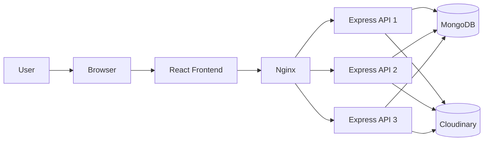

# VidStream

VidStream is a full-stack video streaming platform inspired by YouTube. It allows users to sign up, upload videos, subscribe to creators, like and comment on content, search videos, and manage their channels and watch history in a smooth streaming experience.

## Why VidStream?

This project is designed to mimic the core experience of a modern video-sharing platform while keeping the architecture practical and beginner-friendly. It combines a scalable Node.js backend, a responsive React frontend, and cloud-based media storage to deliver a full end-to-end application that showcases real-world full-stack development patterns.

## System Design



## Features

- JWT-based authentication and refresh tokens
- Video upload, update, delete, and playback
- Subscriptions and channel profiles
- Likes, comments, and community posts
- Search and watch history tracking
- OTP-based password reset via email
- Dockerized deployment with Nginx load balancing

## Project Structure

```text
VidStream/
├── Backend/          # Express API and business logic
├── frontend/         # React + Vite frontend
├── postman/          # API collection for testing
├── docker-compose.yml
├── nginx.conf
├── .env.sample
├── Readme.md
└── LICENSE
```

## Tech Stack

- Frontend: React, Vite, Tailwind CSS
- Backend: Node.js, Express.js
- Database: MongoDB
- Media Storage: Cloudinary
- Deployment: Docker, Nginx

## Quick Start

### 1. Clone the project

```bash
git clone <your-repo-url>
cd VidStream
```

### 2. Backend setup

```bash
cd Backend
cp ../.env.sample .env
npm install
npm run dev
```

### 3. Frontend setup

```bash
cd frontend
npm install
npm run dev
```

- Frontend: http://localhost:3000
- Backend: http://localhost:8000

## Environment Variables

Use the sample environment file and update values for your setup:

```env
PORT=8000
MONGODB_URI=your_mongodb_uri
CLOUDINARY_CLOUD_NAME=your_cloud_name
CLOUDINARY_API_KEY=your_api_key
CLOUDINARY_API_SECRET=your_api_secret
ACCESS_TOKEN_SECRET=your_access_token_secret
REFRESH_TOKEN_SECRET=your_refresh_token_secret
EMAIL=your_email@gmail.com
EMAIL_PASS=your_gmail_app_password
```

## API Overview

The backend exposes REST APIs under `/api/v1` for:

- Users
- Videos
- Subscriptions
- Likes
- Comments
- Tweets
- Search
- Downloads

## Docker

```bash
docker compose up --build
```

This starts the application behind Nginx with multiple backend instances for load balancing.

## License

This project is open source and available under the MIT License.

## Author

Deepak Yadav
